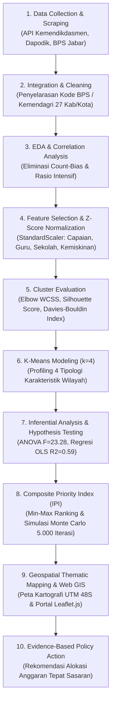
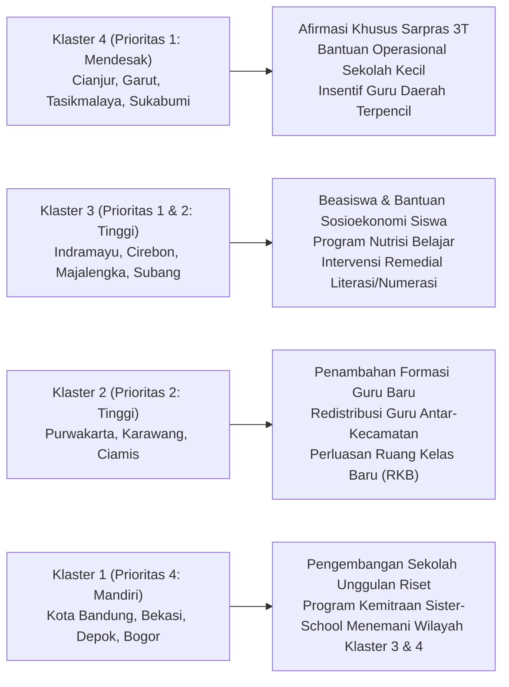

# Klasterisasi Wilayah Pendidikan SMP Jawa Barat Menggunakan K-Means Clustering
> **Analisis Disparitas Mutu Capaian TKA, Kebutuhan Sarana Prasarana, dan Konteks Sosio-Ekonomi di 27 Kabupaten/Kota Jawa Barat**

[](https://www.python.org/downloads/)
[](https://opensource.org/licenses/MIT)
[](https://rap404.github.io/klasterisasi-wilayah-tka/)

---

## 📌 Daftar Isi
1. [Latar Belakang & Urgensi Masalah](#1-latar-belakang--urgensi-masalah)
2. [Alur Metodologi Data Mining (CRISP-DM)](#2-alur-metodologi-data-mining-crisp-dm)
3. [Struktur Direktori Modular Proyek](#3-struktur-direktori-modular-proyek)
4. [Instalasi & Persiapan Lingkungan](#4-instalasi--persiapan-lingkungan)
5. [Panduan Step-by-Step Menjalankan Pipeline](#5-panduan-step-by-step-menjalankan-pipeline)
   - [Opsi A: Eksekusi Otomatis 1-Klik (`run_all.py`)](#opsi-a-eksekusi-otomatis-1-klik-run_allpy)
   - [Opsi B: Eksekusi Manual Bertahap (Step 01 - 07)](#opsi-b-eksekusi-manual-bertahap-step-01---07)
   - [Opsional: Skrip Pengumpulan Data Scraping](#opsional-skrip-pengumpulan-data-scraping)
6. [Tahap 1: Pengumpulan & Sumber Data Primer](#tahap-1-pengumpulan--sumber-data-primer)
7. [Tahap 2: Integrasi & Analisis Eksploratif (EDA)](#tahap-2-integrasi--analisis-eksploratif-eda)
8. [Tahap 3: Seleksi 4 Pilar & Transformasi Z-Score](#tahap-3-seleksi-4-pilar--transformasi-z-score)
9. [Tahap 4: Evaluasi & Validasi Jumlah Klaster Optimal ($k$)](#tahap-4-evaluasi--validasi-jumlah-klaster-optimal-k)
10. [Tahap 5: Pemodelan K-Means & Profiling Wilayah ($k=4$)](#tahap-5-pemodelan-k-means--profiling-wilayah-k4)
11. [Tahap 6: Analisis Inferensial, ANOVA & Regresi Berganda](#tahap-6-analisis-inferensial-anova--regresi-berganda)
12. [Tahap 7: Perhitungan Indeks Prioritas Intervensi (IPI) & Simulasi](#tahap-7-perhitungan-indeks-prioritas-intervensi-ipi--simulasi)
13. [Tahap 8: Integrasi Geospasial, Peta Tematik & Web GIS](#tahap-8-integrasi-geospasial-peta-tematik--web-gis)
14. [Rekomendasi Kebijakan Berbasis Data (Policy Action)](#14-rekomendasi-kebijakan-berbasis-data-policy-action)

---

## 1. Latar Belakang & Urgensi Masalah

Pemerataan kualitas pendidikan jenjang Sekolah Menengah Pertama (SMP) di Provinsi Jawa Barat menghadapi tantangan struktural multidimensi. Disparitas capaian belajar siswa tidak berdiri sendiri, melainkan bertalian erat dengan dua faktor kunci:
1. **Ketersediaan & Beban Sumber Daya Sekolah**: Kepadatan murid per rombel/sekolah serta rasio beban kerja guru pengajar.
2. **Kondisi Sosio-Ekonomi Wilayah**: Tingkat kesejahteraan dan persentase kemiskinan keluarga di daerah setempat.

Proyek data mining ini menyajikan solusi analitis berbasis data kuantitatif (*evidence-based policy*) untuk:
* **Mengidentifikasi pola disparitas pendidikan** di 27 kabupaten/kota Jawa Barat tanpa bias ukuran geografis wilayah (*count-bias*).
* **Mengelompokkan wilayah ke dalam 4 tipologi klaster karakteristik** menggunakan algoritma **K-Means Clustering**.
* **Menyusun Indeks Prioritas Intervensi (IPI)** berbasis pembobotan multi-indikator dan simulasi Monte Carlo untuk mengarahkan alokasi anggaran dan afirmasi sarana secara presisi dan objektif.

---

## 2. Alur Metodologi Data Mining (CRISP-DM)

Alur kerja dirancang mengacu pada standar baku metodologi *Cross-Industry Standard Process for Data Mining* (CRISP-DM):



---

## 3. Struktur Direktori Modular Proyek

Repository telah direstrukturisasi secara profesional ke dalam arsitektur data science modular:

```text
klasterisasi-wilayah-tka/
├── README.md                                # Dokumentasi komprehensif proyek & step-by-step
├── requirements.txt                         # Daftar dependensi library Python
├── run_all.py                               # Master Runner otomatis seluruh pipeline (1-klik)
│
├── dataset/
│   ├── raw/                                 # Data primer mentah multi-sumber
│   │   ├── tka/                             # Capaian TKA SMP & MTs hasil scraping
│   │   ├── infrastruktur_sdm/               # Dapodik: data sekolah, murid, guru, TKP
│   │   ├── sosio_ekonomi/                   # BPS: persentase & garis kemiskinan
│   │   └── geospasial/                      # Poligon batas wilayah 27 kab/kota Jawa Barat
│   ├── processed/                           # Data hasil pengolahan & transformasi pipeline
│   │   ├── jabar_smp_merged.csv             # Dataset gabungan 27 wilayah (33 indikator)
│   │   ├── fitur_kandidat_kmeans_smp.csv    # Fitur kandidat sebelum standardisasi
│   │   ├── fitur_kmeans_smp_standardisasi.csv # Fitur 4 pilar terstandardisasi Z-Score
│   │   ├── hasil_klaster_kmeans_smp.csv     # Data berlabel klaster k=4 & k=3
│   │   ├── indeks_prioritas_intervensi_smp.csv # Tabel lengkap skor IPI & ranking wilayah
│   │   └── kabkota_jabar_klaster_indeks.geojson # Poligon GeoJSON terintegrasi atribut
│   └── dictionary/                          # Metadata & kamus data
│       └── qc_dan_data_dictionary_smp.xlsx
│
├── scripts/                                 # Seluruh skrip pipeline bernomor urut
│   ├── 01_eda_dan_korelasi.py               # Tahap 1: Statistik deskriptif & Pearson correlation
│   ├── 02_standarisasi_fitur.py             # Tahap 2: Seleksi 4 pilar & transformasi Z-Score
│   ├── 03_evaluasi_optimal_k.py             # Tahap 3: Pengujian metrik k (Elbow, Silhouette, DBI)
│   ├── 04_kmeans_clustering.py              # Tahap 4: Fitting K-Means (k=4) & profiling wilayah
│   ├── 05_analisis_inferensial.py           # Tahap 5: Uji ANOVA, Kruskal-Wallis & Regresi OLS
│   ├── 06_indeks_prioritas.py               # Tahap 6: Formula IPI & simulasi Monte Carlo 5.000x
│   ├── 07_visualisasi_geospasial.py         # Tahap 7: Peta Tematik UTM 48S & Peta Web Leaflet.js
│   └── scraping/                            # Skrip crawling data otomatis dari API resmi
│       ├── scrape.py                        # Scraper TKA via dekripsi CryptoJS AES
│       ├── scrape_kabupaten.py              # Scraper per kabupaten/kota
│       └── seleniumm.py                     # Alternatif scraper otomasi web
│
├── outputs/                                 # Artefak hasil komputasi & visualisasi
│   ├── tables/                              # Tabel CSV hasil kalkulasi & evaluasi model
│   │   ├── statistik_deskriptif.csv
│   │   ├── matriks_korelasi.csv
│   │   ├── pasangan_korelasi_tinggi.csv
│   │   ├── evaluasi_optimal_k.csv
│   │   ├── profil_klaster_smp.csv
│   │   ├── korelasi_tka_variabel_pendukung.csv
│   │   ├── regresi_berganda_tka.csv
│   │   └── peringkat_prioritas_intervensi.csv
│   ├── figures/                             # Visualisasi grafik resolusi tinggi & peta tematik
│   │   ├── matriks_korelasi.png
│   │   ├── evaluasi_optimal_k.png
│   │   ├── visualisasi_klaster_kmeans.png
│   │   ├── klaster_scatter_tka_vs_kemiskinan.png
│   │   ├── klaster_scatter_guru_vs_sekolah.png
│   │   ├── klaster_fingerprint_zscore.png
│   │   ├── klaster_distribusi_wilayah.png
│   │   ├── scatter_regresi_tka.png
│   │   ├── boxplot_tka_per_klaster.png
│   │   ├── ranking_prioritas_intervensi.png
│   │   ├── kontribusi_komponen_indeks.png
│   │   ├── peta_klaster_k4.png
│   │   ├── peta_prioritas_intervensi.png
│   │   └── peta_spasial_klaster_dan_prioritas.png
│   └── peta_interaktif_jabar.html           # File web interaktif mandiri
│
└── docs/                                    # Portal Web GIS (GitHub Pages)
    └── index.html                           # Antarmuka peta interaktif publik
```

---

## 4. Instalasi & Persiapan Lingkungan

### 1. Kloning Repository
```bash
git clone https://github.com/Rap404/klasterisasi-wilayah-tka.git
cd klasterisasi-wilayah-tka
```

### 2. Buat & Aktifkan Virtual Environment (Disarankan)
```bash
# Windows
python -m venv venv
venv\Scripts\activate

# Linux / macOS
python3 -m venv venv
source venv/bin/activate
```

### 3. Pasang Dependensi
```bash
pip install -r requirements.txt
```

---

## 5. Panduan Step-by-Step Menjalankan Pipeline

### Opsi A: Eksekusi Otomatis 1-Klik (`run_all.py`)
Untuk mengeksekusi seluruh tahapan analisis (Tahap 01 s/d 07) secara berurutan dan otomatis menghasilkan seluruh tabel, grafik, peta cetak, dan peta web:
```bash
python run_all.py
```
*Total waktu eksekusi: ±30–35 detik.*

---

### Opsi B: Eksekusi Manual Bertahap (Step 01 - 07)

Jika ingin menjalankan atau menelaah setiap tahap satu demi satu, ikuti panduan berikut:

| Tahap | Perintah Terminal | Skrip yang Dieksekusi | Input Data | Output Utama |
| :---: | :--- | :--- | :--- | :--- |
| **01** | `python scripts/01_eda_dan_korelasi.py` | [01_eda_dan_korelasi.py](file:///scripts/01_eda_dan_korelasi.py) | `dataset/processed/jabar_smp_merged.csv` | `outputs/tables/matriks_korelasi.csv`<br>`outputs/figures/matriks_korelasi.png` |
| **02** | `python scripts/02_standarisasi_fitur.py` | [02_standarisasi_fitur.py](file:///scripts/02_standarisasi_fitur.py) | `dataset/processed/jabar_smp_merged.csv` | `dataset/processed/fitur_kmeans_smp_standardisasi.csv` |
| **03** | `python scripts/03_evaluasi_optimal_k.py` | [03_evaluasi_optimal_k.py](file:///scripts/03_evaluasi_optimal_k.py) | `dataset/processed/fitur_kmeans_smp_standardisasi.csv` | `outputs/tables/evaluasi_optimal_k.csv`<br>`outputs/figures/evaluasi_optimal_k.png` |
| **04** | `python scripts/04_kmeans_clustering.py` | [04_kmeans_clustering.py](file:///scripts/04_kmeans_clustering.py) | `dataset/processed/fitur_kmeans_smp_standardisasi.csv` | `dataset/processed/hasil_klaster_kmeans_smp.csv`<br>`outputs/figures/visualisasi_klaster_kmeans.png` |
| **05** | `python scripts/05_analisis_inferensial.py` | [05_analisis_inferensial.py](file:///scripts/05_analisis_inferensial.py) | `dataset/processed/hasil_klaster_kmeans_smp.csv` | `outputs/tables/regresi_berganda_tka.csv`<br>`outputs/figures/scatter_regresi_tka.png` |
| **06** | `python scripts/06_indeks_prioritas.py` | [06_indeks_prioritas.py](file:///scripts/06_indeks_prioritas.py) | `dataset/processed/hasil_klaster_kmeans_smp.csv` | `dataset/processed/indeks_prioritas_intervensi_smp.csv`<br>`outputs/figures/ranking_prioritas_intervensi.png` |
| **07** | `python scripts/07_visualisasi_geospasial.py` | [07_visualisasi_geospasial.py](file:///scripts/07_visualisasi_geospasial.py) | `dataset/raw/geospasial/kabkota_jabar_keyed.geojson`<br>`dataset/processed/indeks_prioritas_intervensi_smp.csv` | `dataset/processed/kabkota_jabar_klaster_indeks.geojson`<br>`outputs/figures/peta_klaster_k4.png`<br>`outputs/figures/peta_prioritas_intervensi.png`<br>`docs/index.html` |

Anda juga dapat menjalankan tahapan spesifik melalui runner:
```bash
# Contoh hanya menjalankan tahap pemodelan klaster (Tahap 4)
python run_all.py --step 4
```

---

### Opsional: Skrip Pengumpulan Data Scraping
Skrip scraping disediakan di folder [`scripts/scraping/`](file:///scripts/scraping/) jika Anda ingin memperbarui data mentah TKA secara langsung dari endpoint resmi Pusmendik Kemendikdasmen:
```bash
python scripts/scraping/scrape.py
```
*Catatan: Skrip ini menggunakan derivasi OpenSSL EVP_BytesToKey dan AES-CBC untuk mendekripsi payload JSON terenkripsi dari server.*

---

## Tahap 1: Pengumpulan & Sumber Data Primer

Dataset proyek bersumber dari integrasi multi-domain primer tahun 2025/2026:
1. **Domain Capaian Akademik (Pusmendik / Kemendikdasmen)**:
   * Skor rerata Tes Kemampuan Akademik (TKA) Matematika (`tka_rerata_mtk`) dan Bahasa Indonesia (`tka_rerata_bind`) jenjang SMP per kabupaten/kota.
2. **Domain Infrastruktur & Ketenagaan (Dapodik Kemendikbud)**:
   * Jumlah sekolah SMP (negeri & swasta), jumlah murid terdaftar, jumlah guru pendidik, dan kualifikasi Tenaga Kependidikan (TKP S1 ke atas).
3. **Domain Sosio-Ekonomi (Badan Pusat Statistik / BPS Jawa Barat)**:
   * Persentase penduduk miskin per wilayah (`pct_penduduk_miskin`) dan garis kemiskinan (Rp/kapita/bulan).
4. **Domain Geospasial**:
   * Poligon batas administrasi 27 kabupaten/kota Jawa Barat (GADM/Kemendagri).

---

## Tahap 2: Integrasi & Analisis Eksploratif (EDA)

Dijalankan melalui:
```bash
python scripts/01_eda_dan_korelasi.py
```

### Eliminasi *Count-Bias* (Multikolinearitas Ekstrem)
Analisis korelasi Pearson membuktikan bahwa variabel jumlah agregat absolut memiliki multikolinearitas ekstrem:
* `guru_total` vs `murid_total`: $r = 0.987$
* `sekolah_total` vs `guru_total`: $r = 0.955$
* `sekolah_total` vs `murid_total`: $r = 0.950$

> [!IMPORTANT]
> **Keputusan Metodologis**: Jumlah absolut mencerminkan ukuran populasi dan luas daerah (contoh: Kabupaten Bogor dengan 5+ juta penduduk vs Kota Cirebon dengan 300 ribu penduduk). Memasukkan variabel agregat akan membuat algoritma hanya mengelompokkan daerah berdasarkan ukuran fisik (*size-bias*). Oleh karena itu, variabel absolut ditransformasikan menjadi **rasio intensif**:
> * **Rasio Murid per Guru (Rasio M/G)**: $\frac{\text{murid\_total}}{\text{guru\_total}}$ (beban kerja pengajaran).
> * **Rasio Murid per Sekolah (Rasio M/S)**: $\frac{\text{murid\_total}}{\text{sekolah\_total}}$ (kepadatan & skala fisik fasilitas).

---

## Tahap 3: Seleksi 4 Pilar & Transformasi Z-Score

Dijalankan melalui:
```bash
python scripts/02_standarisasi_fitur.py
```

### 1. Empat Pilar Fitur Terpilih
Variabel Bahasa Indonesia dieliminasi karena berkorelasi nyaris sempurna ($r = 0.978$) dengan Matematika demi mencegah pembobotan ganda pada dimensi kognitif. Ditetapkan 4 pilar representatif:
* **Pilar 1 (Mutu Akademik)**: `tka_rerata_mtk`
* **Pilar 2 (Beban Pendidik)**: `rasio_murid_guru`
* **Pilar 3 (Kapasitas Fasilitas)**: `rasio_murid_sekolah`
* **Pilar 4 (Konteks Sosio-Ekonomi)**: `pct_penduduk_miskin`

### 2. Standarisasi Z-Score
Algoritma K-Means mengukur kedekatan menggunakan jarak Euclidean:

$$d(p, q) = \sqrt{\sum_{j=1}^{d} (p_j - q_j)^2}$$

Karena skala satuan sangat bervariasi (rasio sekolah berkisar 200–450, persentase kemiskinan 2–11%, dan skor TKA 37–45), seluruh fitur ditransformasikan ke skala Z-Score ($z = \frac{x - \mu}{\sigma}$), menghasilkan $\mu = 0$ dan $\sigma = 1$.

---

## Tahap 4: Evaluasi & Validasi Jumlah Klaster Optimal ($k$)

Dijalankan melalui:
```bash
python scripts/03_evaluasi_optimal_k.py
```

Pengujian klaster dilakukan untuk rentang $k = 2$ hingga $k = 8$ menggunakan 4 metrik independen:

| $k$ | WCSS / Inertia *(Elbow)* | Silhouette Score | Davies-Bouldin Index (DBI) | Calinski-Harabasz |
| :---: | :---: | :---: | :---: | :---: |
| **2** | 63.07 | 0.3576 | 1.0977 | 17.81 |
| **3** | 48.61 | 0.2942 | 1.1263 | 14.66 |
| **4** | **35.54** *(Elbow Point)* | **0.3177** *(Meningkat)* | **1.0444** *(Membaik)* | 15.63 |
| **5** | 28.95 | 0.3342 | 0.9003 | 15.02 |
| **6** | 24.10 | 0.3219 | 0.8109 | 14.62 |

### Justifikasi Pemilihan $k = 4$:
1. **Penurunan WCSS Signifikan**: Titik siku (*elbow point*) terlihat jelas pada $k=4$, di mana penurunan inertia melandai tajam setelah $k=4$.
2. **Kualitas Separasi Ruang**: Silhouette Score pada $k=4$ ($0.3177$) meningkat dibanding $k=3$ ($0.2942$), diiringi perbaikan Davies-Bouldin Index ($1.0444$).
3. **Interpretasi Kebijakan**: $k=4$ memisahkan karakteristik wilayah secara alami ke dalam 4 kuadran kebijakan praktis tanpa memecah data menjadi mikro-klaster yang tidak representatif ($n=27$).

---

## Tahap 5: Pemodelan K-Means & Profiling Wilayah ($k=4$)

Dijalankan melalui:
```bash
python scripts/04_kmeans_clustering.py
```

### Profil Rerata Karakteristik 4 Klaster Wilayah:
| Klaster & Label Profil | Jml Wilayah | Rerata TKA MTK | Rasio Murid:Guru | Rasio Murid:Sekolah | Penduduk Miskin (%) | Anggota Wilayah |
| :--- | :---: | :---: | :---: | :---: | :---: | :--- |
| **Klaster 1: Perkotaan, Capaian Tinggi** | 7 | **44.09** | 19.19 | 352.96 | **4.03%** | Kota Bandung, Kota Bogor, Kota Depok, Kota Cimahi, Kota Bekasi, Kab. Bekasi, Kab. Bandung |
| **Klaster 2: Beban Kelas Tinggi, Capaian Menengah** | 4 | **40.31** | **21.22** | **358.21** | 6.42% | Kab. Karawang, Kab. Purwakarta, Kab. Ciamis, Kota Sukabumi |
| **Klaster 3: Kemiskinan Tinggi, Capaian Menengah** | 10 | **40.21** | 17.46 | 334.32 | **9.97%** | Kab. Indramayu, Kab. Cirebon, Kab. Kuningan, Kab. Majalengka, Kab. Sumedang, Kab. Subang, Kab. Bandung Barat, Kota Cirebon, Kota Tasikmalaya, Kota Banjar |
| **Klaster 4: Capaian Rendah, Skala Sekolah Terbatas** | 6 | **38.83** | 16.75 | **241.73** | 8.10% | Kab. Cianjur, Kab. Garut, Kab. Tasikmalaya, Kab. Sukabumi, Kab. Bogor, Kab. Pangandaran |

---

## Tahap 6: Analisis Inferensial, ANOVA & Regresi Berganda

Dijalankan melalui:
```bash
python scripts/05_analisis_inferensial.py
```

### 1. Uji Signifikansi Pemisahan Klaster
* **ANOVA Satu Arah (One-Way ANOVA)**: $F = 23.28$, $p = 3.73 \times 10^{-7}$ ($p < 0.001$).
* **Kruskal-Wallis**: $H = 16.12$, $p = 0.00107$ ($p < 0.01$).
* *Kesimpulan*: Pemisahan keempat klaster terbukti valid, kokoh, dan signifikan secara statistik.

### 2. Model Regresi Linier Berganda (OLS)
Pemodelan faktor penjelas terhadap capaian TKA Matematika:

$$\text{TKA MTK} = \beta_0 + \beta_1 (\text{Rasio M/G}) + \beta_2 (\text{Rasio M/S}) + \beta_3 (\text{Pmiskin}) + \epsilon$$

* **Koefisien Determinasi**: $R^2 = 0.5903$ ($\text{Adjusted } R^2 = 0.5368$).
* **Uji Simultan**: $F(3, 23) = 11.04$, $p = 0.000109$.
* Sebanyak **$59.03\%$ variasi capaian TKA Matematika** di Jawa Barat dapat dijelaskan secara simultan oleh kombinasi beban guru, skala sekolah, dan tingkat kemiskinan daerah.

---

## Tahap 7: Perhitungan Indeks Prioritas Intervensi (IPI) & Simulasi

Dijalankan melalui:
```bash
python scripts/06_indeks_prioritas.py
```

### Formula Pembobotan Multidimensi:
Indeks Prioritas Intervensi (IPI) dirumuskan dalam skala 0–100 (makin tinggi nilai, makin mendesak kebutuhan intervensi):

$$\text{IPI} = 100 \times \Big[ 0.50 \cdot D_{\text{TKA}} + 0.25 \cdot D_{\text{Miskin}} + 0.125 \cdot D_{\text{Sekolah}} + 0.125 \cdot D_{\text{Guru}} \Big]$$

Seluruh indikator dinormalisasi secara Min-Max searah urgensi:
* $D_{\text{TKA}} = \frac{\max(\text{TKA}) - \text{TKA}_i}{\max(\text{TKA}) - \min(\text{TKA})}$ (skor rendah = lebih mendesak).
* $D_{\text{Miskin}} = \frac{\text{Miskin}_i - \min(\text{Miskin})}{\max(\text{Miskin}) - \min(\text{Miskin})}$ (kemiskinan tinggi = lebih mendesak).
* $D_{\text{Sekolah}} = \frac{\max(\text{Rasio M/S}) - \text{Rasio M/S}_i}{\max(\text{Rasio M/S}) - \min(\text{Rasio M/S})}$ (sekolah kecil/terisolasi = lebih mendesak).
* $D_{\text{Guru}} = \frac{\text{Rasio M/G}_i - \min(\text{Rasio M/G})}{\max(\text{Rasio M/G}) - \min(\text{Rasio M/G})}$ (beban guru padat = lebih mendesak).

### Uji Kekokohan Sensitivitas Monte Carlo (5.000 Iterasi)
Untuk memastikan peringkat tidak rentan terhadap subjektivitas bobot, dijalankan **5.000 kali simulasi Monte Carlo** dengan memvariasikan bobot capaian secara acak antara 40%–60% dan membagi sisa bobot melalui distribusi Dirichlet:
* **Wilayah Robust (Konsisten Masuk 8 Besar pada $\ge 80\%$ Variasi Bobot)**:
  1. **Kabupaten Cianjur** (100% konsisten peringkat #1)
  2. **Kabupaten Indramayu** (99% konsisten top 5)
  3. **Kabupaten Garut** (95% konsisten top 5)
  4. **Kabupaten Sukabumi** (81% konsisten top 8)

### Klasifikasi Tiering Prioritas (27 Kabupaten/Kota):
* **Prioritas 1 (Mendesak / Skor $\ge 70$)**: Cianjur (#1, 89.92), Indramayu (#2, 83.67), Garut (#3, 79.69), Tasikmalaya (#4, 78.23), Sukabumi (#5, 74.36), Majalengka (#6, 71.16), Cirebon (#7, 70.14).
* **Prioritas 2 (Tinggi / Skor 60–69.9)**: Subang (#8, 69.49), Bandung Barat (#9, 66.93), Purwakarta (#10, 66.46), Kuningan (#11, 64.99), Pangandaran (#12, 64.24), Ciamis (#13, 63.85), Karawang (#14, 62.77), Sumedang (#15, 60.10).
* **Prioritas 3 (Menengah / Skor 40–59.9)**: Kota Cirebon (#16), Kota Tasikmalaya (#17), Kota Banjar (#18), Kab. Bogor (#19), Kota Sukabumi (#20), Kab. Bandung (#21).
* **Prioritas 4 (Mandiri / Skor $< 40$)**: Kab. Bekasi (#22), Kota Bogor (#23), Kota Bekasi (#24), Kota Cimahi (#25), Kota Depok (#26), Kota Bandung (#27).

---

## Tahap 8: Integrasi Geospasial, Peta Tematik & Web GIS

Dijalankan melalui:
```bash
python scripts/07_visualisasi_geospasial.py
```

### 1. Kartografi Cetak Resolusi Tinggi (UTM Zone 48S)
Skrip memproyeksikan koordinat WGS84 ke sistem metrik **UTM Zone 48S (EPSG:32748)** untuk mempertahankan skala bentuk geografis Jawa Barat secara akurat:
* **Callout Otomatis Kota Kecil**: 9 kota berluas kecil (<250 km²) diberi garis penunjuk rapi ke sisi luar peta agar tidak bertumpukan.
* **Garis Batas Robust**: Wilayah prioritas yang kokoh pada 5.000 simulasi ditandai dengan garis batas ganda hitam dan simbol bintang ($\bigstar$).
* File visualisasi disimpan di:
  * [`outputs/figures/peta_klaster_k4.png`](file:///outputs/figures/peta_klaster_k4.png)
  * [`outputs/figures/peta_prioritas_intervensi.png`](file:///outputs/figures/peta_prioritas_intervensi.png)
  * [`outputs/figures/peta_spasial_klaster_dan_prioritas.png`](file:///outputs/figures/peta_spasial_klaster_dan_prioritas.png)

### 2. Portal Web GIS Interaktif (Leaflet.js)
Tersedia portal web geospasial interaktif berbasis client-side murni tanpa server backend:
* **Toggling Layer**: Berpindah secara instan antara visualisasi Tipologi Klaster dan Prioritas Intervensi IPI.
* **Panel Detail Interaktif**: Klik pada poligon menampilkan metrik lengkap 4 pilar, peringkat, dan skor IPI.
* **Dropdown Navigasi Wilayah**: Fitur pencarian dan pemfokusan otomatis batas wilayah (*zoom & pan*).
* Akses langsung file lokal di [`outputs/peta_interaktif_jabar.html`](file:///outputs/peta_interaktif_jabar.html) atau portal daring di **[GitHub Pages](https://rap404.github.io/klasterisasi-wilayah-tka/)**.

---

## 14. Rekomendasi Kebijakan Berbasis Data (Policy Action)

Berdasarkan sintesis antara karakteristik klaster dan skor urgensi intervensi, dirumuskan strategi kebijakan spesifik:



1. **Klaster 4 (Capaian Rendah & Skala Terbatas - Alokasi Anggaran Utama)**:
   * **Tantangan**: Skor TKA Matematika terendah (38.83), ukuran sekolah kecil dan tersebar (rasio 241 murid/sekolah) di wilayah perbukitan/pesisir selatan Jawa Barat.
   * **Solusi**: Alokasi anggaran afirmasi fisik (rehabilitasi laboratorium komputer dan akses internet satelit), pendirian SMP Terbuka/Satu Atap, serta tunjangan khusus guru daerah tertinggal.
2. **Klaster 3 (Tantangan Sosio-Ekonomi & Kemiskinan Tinggi - Afirmasi Biaya Siswa)**:
   * **Tantangan**: Persentase kemiskinan tertinggi di Jawa Barat (rerata 9.97%), capaian akademik menengah bawah.
   * **Solusi**: Integrasi beasiswa pendidikan daerah dengan program perlindungan sosial (KIP Daerah, subsidi perlengkapan belajar, dan klinik remedial numerasi).
3. **Klaster 2 (Beban Pengajaran Guru Padat - Pemerataan Tenaga Pendidik)**:
   * **Tantangan**: Rasio murid per guru paling padat (21.22) dan rombel besar (358 murid/sekolah) di kawasan industri/penyangga.
   * **Solusi**: Moratorium pembukaan sekolah baru tanpa formasi guru, redistribusi guru dari wilayah perkotaan jenuh, dan penambahan kuota PPPK Guru SMP.
4. **Klaster 1 (Wilayah Perkotaan Mandiri - Hub Kolaborasi Pendidikan)**:
   * **Tantangan**: Kualitas pendidikan relatif unggul (TKA MTK 44.09), kemiskinan sangat rendah (4.03%).
   * **Solusi**: Menjadi *hub pendampingan* (*sister-school*) bagi sekolah-sekolah di Klaster 3 dan Klaster 4 untuk transfer praktik baik pedagogik dan penguatan materi asesmen numerasi.

---

<p align="center">
  <b>Dibuat untuk Kompetisi Data Mining & Analitik Kebijakan Publik Jawa Barat</b><br>
  <i>Integritas Data &bull; Metodologi Kuantitatif Baku &bull; Rekomendasi Presisi</i>
</p>
