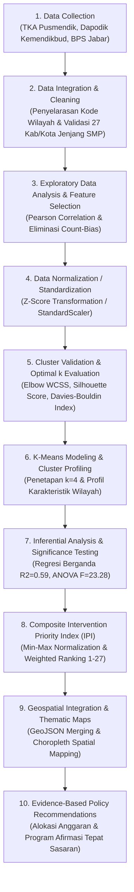

# Klasterisasi Wilayah Pendidikan SMP Jawa Barat Menggunakan K-Means Clustering
> **Analisis Disparitas Mutu Capaian TKA, Kebutuhan Sarana Prasarana, dan Konteks Sosio-Ekonomi di 27 Kabupaten/Kota Jawa Barat**

---

## Daftar Isi
1. [Latar Belakang & Tujuan](#1-latar-belakang--tujuan)
2. [Alur Kerja Data Mining (Pipeline)](#2-alur-kerja-data-mining-pipeline)
3. [Tahap 1: Pengumpulan & Sumber Data](#tahap-1-pengumpulan--sumber-data)
4. [Tahap 2: Integrasi & Pembersihan Data](#tahap-2-integrasi--pembersihan-data)
5. [Tahap 3: Analisis Eksploratif (EDA) & Multikolinearitas](#tahap-3-analisis-eksploratif-eda--multikolinearitas)
6. [Tahap 4: Seleksi Fitur & Standardisasi Data](#tahap-4-seleksi-fitur--standardisasi-data)
7. [Tahap 5: Evaluasi Penentuan Jumlah Klaster Optimal (k)](#tahap-5-evaluasi-penentuan-jumlah-klaster-optimal-k)
8. [Tahap 6: Eksekusi K-Means Clustering & Profiling Wilayah (k=4)](#tahap-6-eksekusi-k-means-clustering--profiling-wilayah-k4)
9. [Tahap 7: Analisis Inferensial Hubungan Variabel Pendukung (ANOVA & Regresi)](#tahap-7-analisis-inferensial-hubungan-variabel-pendukung-anova--regresi)
10. [Tahap 8: Penyusunan Formula & Bobot Indeks Prioritas Intervensi (IPI)](#tahap-8-penyusunan-formula--bobot-indeks-prioritas-intervensi-ipi)
11. [Tahap 9: Integrasi Geospasial & Pembuatan Peta Tematik Wilayah](#tahap-9-integrasi-geospasial--pembuatan-peta-tematik-wilayah)
12. [Rekomendasi Kebijakan Berbasis Data (Policy Action)](#11-rekomendasi-kebijakan-berbasis-data-policy-action)
13. [Struktur Direktori Proyek](#12-struktur-direktori-proyek)
14. [Panduan Menjalankan Skrip](#13-panduan-menjalankan-skrip)

---

## 1. Latar Belakang & Tujuan

Pemerataan kualitas pendidikan jenjang Sekolah Menengah Pertama (SMP) di Provinsi Jawa Barat menghadapi tantangan multidimensi. Disparitas mutu hasil belajar siswa tidak hanya dipengaruhi oleh faktor internal proses belajar mengajar, melainkan berkaitan erat dengan:
1. **Daya tampung sarana fisik dan kecukupan tenaga pendidik**.
2. **Kondisi kesejahteraan sosio-ekonomi keluarga siswa di wilayah tersebut**.

Proyek data mining ini bertujuan untuk:
* Mengidentifikasi pola disparitas pendidikan di 27 kabupaten/kota Jawa Barat secara objektif dan matematis.
* Mengelompokkan wilayah ke dalam 4 klaster profil karakteristik yang komprehensif (*Klaster 1: Perkotaan, Capaian Tinggi*, *Klaster 2: Beban Kelas Tinggi, Capaian Menengah*, *Klaster 3: Kemiskinan Tinggi, Capaian Menengah*, dan *Klaster 4: Capaian Rendah, Skala Sekolah Terbatas*).
* Menyusun **Indeks Prioritas Intervensi (IPI)** berbasis pemodelan kuantitatif untuk memberikan panduan urutan peringkat alokasi anggaran dan program afirmasi pendidikan.

---

## 2. Alur Kerja Data Mining (Pipeline)

Proses data mining dilakukan mengacu pada metodologi baku CRISP-DM (*Cross-Industry Standard Process for Data Mining*):



---

## Tahap 1: Pengumpulan & Sumber Data

Dataset dikumpulkan dari tiga domain data primer:
1. **Domain Capaian Akademik**:
   * Data nilai rerata Tes Kemampuan Akademik (TKA) jenjang SMP bidang Matematika (`tka_rerata_mtk`) dan Bahasa Indonesia (`tka_rerata_bind`) yang diperoleh dari hasil *web scraping* resmi.
2. **Domain Infrastruktur & SDM Pendidikan (Dapodik Kemendikbud)**:
   * Jumlah sekolah SMP (negeri dan swasta).
   * Jumlah guru dan tenaga kependidikan (TKP).
   * Jumlah murid terdaftar.
3. **Domain Sosio-Ekonomi Daerah (BPS Jawa Barat)**:
   * Persentase penduduk miskin per kabupaten/kota (`pct_penduduk_miskin`).
   * Garis kemiskinan (Rp/kapita/bulan).
4. **Domain Spasial**:
   * Peta batas administrasi 27 kabupaten/kota Provinsi Jawa Barat dalam format GeoJSON.

---

## Tahap 2: Integrasi & Pembersihan Data

* **Penyelarasan Entitas**: Penggabungan multi-sumber data dilakukan menggunakan pencocokan ganda: `kode_wilayah` (Kemendagri), `kode_bps`, dan nama kabupaten/kota resmi Jawa Barat.
* **Filter Jenjang**: Difokuskan spesifik pada jenjang SMP di seluruh 27 kabupaten/kota (18 kabupaten dan 9 kota).
* **Validasi Kualitas Data**: Dilakukan pengecekan *missing value* ($0$ nilai kosong ditemukan) dan penyeragaman tipe data ke format floating-point numerik.
* **Output Tahap Ini**: Disimpan dalam file [`dataset/jabar_smp_merged.csv`](file:///dataset/jabar_smp_merged.csv) dan [`dataset/dataset_final_smp.csv`](file:///dataset/dataset_final_smp.csv).

---

## Tahap 3: Analisis Eksploratif (EDA) & Multikolinearitas

Analisis korelasi dijalankan melalui skrip [`clustering/statistik_grafik/korelasi.py`](file:///clustering/statistik_grafik/korelasi.py) menggunakan koefisien korelasi Pearson:

$$r_{xy} = \frac{\sum_{i=1}^{n} (x_i - \bar{x})(y_i - \bar{y})}{\sqrt{\sum_{i=1}^{n} (x_i - \bar{x})^2} \sqrt{\sum_{i=1}^{n} (y_i - \bar{y})^2}}$$

### Alasan Pengambilan Keputusan (Eliminasi *Count-Bias*):
1. **Masalah Variabel Agregat Mentah**:
   * Ditemukan multikolinearitas ekstrem pada variabel jumlah absolut:
     * `guru_total` vs `murid_total` ($r = 0.987$)
     * `sekolah_total` vs `guru_total` ($r = 0.955$)
     * `sekolah_total` vs `murid_total` ($r = 0.950$)
   * *Alasan Keputusan*: Jumlah absolut sangat bias terhadap luas geografis dan jumlah penduduk kabupaten (misal Kabupaten Bogor berpenduduk 5+ juta jiwa vs Kota Cirebon berpenduduk 300 ribu jiwa). Jika dimasukkan ke klasterisasi, algoritma hanya akan mengelompokkan wilayah berdasarkan ukuran daerah (*size-bias*), bukan mutu pendidikannya.
2. **Solusi Perhitungan Rasio**:
   * Dihitung variabel intensif:
     * **Rasio Murid per Guru**: $\text{Rasio M/G} = \frac{\text{murid\_total}}{\text{guru\_total}}$ (mengukur beban pengajaran guru).
     * **Rasio Murid per Sekolah**: $\text{Rasio M/S} = \frac{\text{murid\_total}}{\text{sekolah\_total}}$ (mengukur skala dan kepadatan gedung sekolah).
3. **Temuan Korelasi Akademik & Kemiskinan**:
   * Korelasi `tka_rerata_bind` dan `tka_rerata_mtk` sebesar **$0.978$** (hampir sempurna).
   * Korelasi antara skor TKA dengan `pct_penduduk_miskin` bernilai negatif kuat ($r = -0.62$ s/d $-0.65$), membuktikan bahwa kondisi ekonomi daerah berpengaruh signifikan terhadap capaian akademik siswa.

---

## Tahap 4: Seleksi Fitur & Standardisasi Data

Dijalankan melalui skrip [`clustering/standarisasi.py`](file:///clustering/standarisasi.py).

### 1. Empat Fitur Terpilih
Setelah melalui analisis multikolinearitas (di mana `tka_rerata_bind` dieliminasi karena memiliki korelasi $r = 0.978$ yang nyaris sempurna dengan Matematika guna mencegah bobot ganda), ditetapkan **4 fitur representatif**:
* **Pilar Mutu Akademik**: `tka_rerata_mtk` (Capaian Numerasi/Matematika).
* **Pilar Beban SDM Pendidik**: `rasio_murid_guru` (Kecukupan tenaga guru).
* **Pilar Kapasitas Sarana Fisik**: `rasio_murid_sekolah` (Kepadatan dan skala sekolah).
* **Pilar Konteks Sosio-Ekonomi**: `pct_penduduk_miskin` (Persentase penduduk miskin).

### 2. Rumus Standardisasi (Z-Score Normalization)
Algoritma K-Means mengukur kemiripan antar-daerah menggunakan **jarak Euclidean**:

$$d(p, q) = \sqrt{\sum_{j=1}^{d} (p_j - q_j)^2}$$

Karena satuan masing-masing fitur sangat berbeda (rasio murid per sekolah bernilai $200 - 450$, sedangkan kemiskinan bernilai $2\% - 11\%$, dan nilai TKA berkisar $37 - 45$), seluruh fitur ditransformasikan ke skala Z-Score:

$$z = \frac{x - \mu}{\sigma}$$

Di mana $\mu = \frac{1}{N}\sum x_i$ dan $\sigma = \sqrt{\frac{1}{N}\sum (x_i - \mu)^2}$. Setelah transformasi: $\mu = 0$ dan $\sigma = 1$ untuk seluruh fitur.
* **Output**: Disimpan di [`dataset/fitur_kmeans_smp_standardisasi.csv`](file:///dataset/fitur_kmeans_smp_standardisasi.csv).

---

## Tahap 5: Evaluasi Penentuan Jumlah Klaster Optimal ($k$)

Dijalankan melalui skrip [`clustering/evaluasi_k.py`](file:///clustering/evaluasi_k.py). Pengujian dilakukan untuk rentang $k = 2$ hingga $k = 8$.

### Tiga Metrik Pengujian:

#### 1. Elbow Method (Within-Cluster Sum of Squares / WCSS)
$$\text{WCSS} = \sum_{k=1}^{K} \sum_{x \in C_k} ||x - \mu_k||^2$$

#### 2. Silhouette Coefficient
$$s(i) = \frac{b(i) - a(i)}{\max(a(i), b(i))}$$

#### 3. Davies-Bouldin Index (DBI)
$$DB = \frac{1}{k}\sum_{i=1}^{k} \max_{j \neq i} \left( \frac{\bar{d}_i + \bar{d}_j}{d(c_i, c_j)} \right)$$

### Tabel Hasil Evaluasi Metrik:
| $k$ (Jumlah Klaster) | WCSS / Inertia *(Elbow)* | Silhouette Score | Davies-Bouldin Index | Calinski-Harabasz |
| :---: | :---: | :---: | :---: | :---: |
| **2** | 63.07 | 0.3576 | 1.0977 | 17.81 |
| **3** | 48.61 | 0.2942 | 1.1263 | 14.66 |
| **4** | **35.54** *(Optimal)* | **0.3177** *(Meningkat)* | **1.0444** *(Membaik)* | 15.63 |
| **5** | 28.95 | 0.3342 | 0.9003 | 15.02 |
| **6** | 24.10 | 0.3219 | 0.8109 | 14.62 |

### Alasan Keputusan Memilih $k = 4$ Sebagai Model Utama:
1. **Peningkatan Kualitas Matematis dibanding $k=3$**: Pada konfigurasi 4 fitur, nilai *Silhouette Score* pada $k=4$ ($0.318$) lebih tinggi daripada $k=3$ ($0.294$), dan *Davies-Bouldin Index* membaik dari $1.126$ turun menjadi $1.044$.
2. **Dekomposisi Masalah Nyata**: Pada $k=3$, wilayah dengan tantangan kemiskinan tinggi (Pantura/Ciayumajakuning) bercampur dengan wilayah sekolah kecil pelosok pegunungan (Jabar Selatan). Pada **$k=4$**, kedua kelompok ini terpisah secara alami menjadi klaster yang spesifik dan sangat mudah diintervensi oleh kebijakan dinas.
* **Output Grafik & Data**: [`clustering/statistik_grafik/grafik_eda/evaluasi_optimal_k.png`](file:///clustering/statistik_grafik/grafik_eda/evaluasi_optimal_k.png) dan [`evaluasi_optimal_k.csv`](file:///clustering/statistik_grafik/evaluasi_optimal_k.csv).

---

## Tahap 6: Eksekusi K-Means Clustering & Profiling Wilayah ($k=4$)

Dijalankan melalui skrip [`clustering/kmeans_clustering.py`](file:///clustering/kmeans_clustering.py) dengan menetapkan $k=4$ (utama) dan $k=3$ (pembanding).

### Profil Karakteristik 4 Klaster Terbentuk

Tabel ringkasan rata-rata nilai asli tiap klaster yang disimpan pada [`clustering/statistik_grafik/profil_klaster_smp.csv`](file:///clustering/statistik_grafik/profil_klaster_smp.csv):

| Fitur / Indikator | Klaster 1: Perkotaan, Capaian Tinggi | Klaster 2: Beban Kelas Tinggi | Klaster 3: Kemiskinan Tinggi | Klaster 4: Capaian Rendah, Skala Sekolah Terbatas | Rerata Jabar |
| :--- | :---: | :---: | :---: | :---: | :---: |
| **Jumlah Wilayah** | **5 daerah** (semua Kota) | **6 daerah** (5 Kab, 1 Kota) | **9 daerah** (7 Kab, 2 Kota) | **7 daerah** (6 Kab, 1 Kota) | 27 daerah |
| **Rerata TKA Matematika** | **44.09** *(Tinggi)* | **40.31** *(Menengah)* | **40.21** *(Menengah)* | **38.83** *(Rendah)* | 40.59 |
| **Rasio Murid per Guru** | **19.19** | **21.22** *(Paling Padat)* | **17.46** | **16.75** *(Longgar)* | 18.43 |
| **Rasio Murid per Sekolah**| **352.96** | **358.21** *(Besar)* | **334.32** | **241.73** *(Skala Terbatas)* | 319.06 |
| **% Penduduk Miskin** | **4.03%** *(Rendah)* | **6.42%** *(Rendah-Sedang)* | **9.97%** *(Tinggi)* | **8.10%** *(Sedang-Tinggi)* | 7.59% |

---

### Penjelasan & Anggota Masing-Masing Klaster ($k=4$)

#### 1. Klaster 1: Perkotaan, Capaian Tinggi (5 Daerah)
* **Anggota**: *Kota Bandung, Kota Bekasi, Kota Depok, Kota Cimahi, Kota Bogor*.
* **Karakteristik**:
  * Seluruh anggotanya adalah kota otonom metropolitan utama.
  * Capaian TKA Matematika konsisten pada taraf tinggi (rata-rata 44.09, rentang 43.35 - 44.71).
  * Persentase kemiskinan rendah (rata-rata 4.03%, rentang 2.31% - 5.89%).

#### 2. Klaster 2: Beban Kelas Tinggi, Capaian Menengah (6 Daerah)
* **Anggota**: *Kabupaten Bogor, Kabupaten Bandung, Kabupaten Purwakarta, Kabupaten Karawang, Kabupaten Bekasi, Kota Sukabumi*.
* **Karakteristik**:
  * Didominasi kawasan penyangga industri dengan populasi siswa sangat padat.
  * **Krisis Beban Guru & Gedung**: Rasio murid per guru tinggi (**21.22**, Karawang bahkan **24.23** dan Bogor **23.00**), serta rasio murid per sekolah terbesar (**358.21**).

#### 3. Klaster 3: Kemiskinan Tinggi, Capaian Menengah (9 Daerah)
* **Anggota**: *Kabupaten Kuningan, Kabupaten Cirebon, Kabupaten Majalengka, Kabupaten Sumedang, Kabupaten Indramayu, Kabupaten Subang, Kabupaten Bandung Barat, Kota Cirebon, Kota Tasikmalaya*.
* **Karakteristik**:
  * Terkonsentrasi di wilayah Pantura dan Ciayumajakuning.
  * **Tingkat Kemiskinan Tinggi di Jabar**: Rata-rata **9.97%** (rentang 8.66% – 11.02%, dengan Indramayu 11.02%, Kuningan 10.74%, Majalengka 10.31%, Cirebon 10.23%). Capaian TKA berada di level menengah (40.21).

#### 4. Klaster 4: Capaian Rendah, Skala Sekolah Terbatas (7 Daerah)
* **Anggota**: *Kabupaten Sukabumi, Kabupaten Cianjur, Kabupaten Garut, Kabupaten Tasikmalaya, Kabupaten Ciamis, Kabupaten Pangandaran, Kota Banjar*.
* **Karakteristik**:
  * Mendominasi wilayah Jawa Barat bagian selatan dan Priangan Timur.
  * **Skala Sekolah Terbatas & TKA Rendah**: Rasio murid per sekolah rendah (**241.73**, Tasikmalaya 205.9, Cianjur 219.1, Sukabumi 223.1 murid/sekolah) serta capaian akademik pada taraf rendah (rata-rata TKA 38.83, rentang 37.59 – 39.75).
  * **Output Grafik Visualisasi Klaster**:
  * Panel Gabungan 4-in-1: [`clustering/statistik_grafik/grafik_eda/visualisasi_klaster_kmeans.png`](file:///clustering/statistik_grafik/grafik_eda/visualisasi_klaster_kmeans.png)
  * Grafik Terpisah 1 (TKA vs Kemiskinan): [`clustering/statistik_grafik/grafik_eda/klaster_scatter_tka_vs_kemiskinan.png`](file:///clustering/statistik_grafik/grafik_eda/klaster_scatter_tka_vs_kemiskinan.png)
  * Grafik Terpisah 2 (Beban Guru vs Skala Sekolah): [`clustering/statistik_grafik/grafik_eda/klaster_scatter_guru_vs_sekolah.png`](file:///clustering/statistik_grafik/grafik_eda/klaster_scatter_guru_vs_sekolah.png)
  * Grafik Terpisah 3 (Fingerprint Z-Score 4 Fitur): [`clustering/statistik_grafik/grafik_eda/klaster_fingerprint_zscore.png`](file:///clustering/statistik_grafik/grafik_eda/klaster_fingerprint_zscore.png)
  * Grafik Terpisah 4 (Distribusi Daerah per Klaster): [`clustering/statistik_grafik/grafik_eda/klaster_distribusi_wilayah.png`](file:///clustering/statistik_grafik/grafik_eda/klaster_distribusi_wilayah.png)

---


## Tahap 7: Analisis Inferensial Hubungan Variabel Pendukung (ANOVA & Regresi)

Dijalankan melalui skrip [`clustering/statistik_grafik/analisis_variabel_pendukung.py`](file:///clustering/statistik_grafik/analisis_variabel_pendukung.py). Tahap ini bertujuan untuk memvalidasi secara ilmiah signifikansi pengaruh variabel pendukung terhadap capaian akademik, serta menguji apakah perbedaan antarklaster signifikan secara statistik.

### 1. Korelasi & Regresi Linear Sederhana
Pengujian hubungan bivariat terhadap target `tka_rerata_mtk`:
* **Persentase Kemiskinan**:
  * Pearson $r = -0.622$ ($p = 0.0005$, **sangat signifikan** pada $\alpha = 0.001$).
  * Spearman $\rho = -0.579$ ($p = 0.0015$).
  * Slope regresi $= -0.5182$, dengan Koefisien Determinasi $R^2 = 0.387$ ($38.7\%$ variasi capaian TKA dapat dijelaskan oleh tingkat kemiskinan).
* **Rasio Murid per Sekolah**:
  * Pearson $r = 0.457$ ($p = 0.0167$, **signifikan** pada $\alpha = 0.05$).
  * $R^2 = 0.208$ ($20.8\%$ variasi TKA berhubungan positif dengan ukuran/kepadatan sekolah).
* **Rasio Murid per Guru**:
  * Pearson $r = 0.065$ ($p = 0.7467$, tidak berkorelasi linier langsung secara bivariat).

### 2. Uji Beda Rerata Signifikan Antar-Klaster ($k=4$)
* **One-Way ANOVA**: $F = 23.278$ ($p = 0.0000 < 0.0001$).
* **Kruskal-Wallis Test**: $H = 16.117$ ($p = 0.0011 < 0.01$).
* **Kesimpulan**: Perbedaan nilai TKA antarklaster pada model $k=4$ **terbukti sangat nyata dan signifikan secara statistik** (daya diskriminasi meningkat lebih dari dua kali lipat dibanding model $k=3$ dengan $F=10.54$).

### 3. Model Regresi Linier Berganda (Eksploratif)
$$\widehat{\text{TKA}} = 44.91 - 0.314 \cdot \text{Rasio M/G} + 0.017 \cdot \text{Rasio M/S} - 0.520 \cdot \text{Miskin}$$
* **Koefisien Determinasi ($R^2$)**: $0.590$ ($R^2_{\text{adj}} = 0.537, n=27$). Artinya, **$59.0\%$ variasi capaian TKA antarwilayah dapat dijelaskan secara simultan** oleh kombinasi beban guru, skala sekolah, dan tingkat kemiskinan.
* **Signifikansi Koefisien Parsial**:
  * Persentase Kemiskinan: Koefisien $-0.520$ ($p = 0.0002$, efek negatif sangat kuat).
  * Rasio Murid per Sekolah: Koefisien $+0.017$ ($p = 0.0037$, efek skala fasilitas sekolah).
  * Rasio Murid per Guru: Koefisien $-0.314$ ($p = 0.0322$, efek negatif beban guru setelah mengontrol ukuran sekolah dan kemiskinan).
* **Output Grafik & Data**: [`clustering/statistik_grafik/korelasi_tka_variabel_pendukung.csv`](file:///clustering/statistik_grafik/korelasi_tka_variabel_pendukung.csv), [`regresi_berganda_tka.csv`](file:///clustering/statistik_grafik/regresi_berganda_tka.csv), [`grafik_eda/heatmap_korelasi.png`](file:///clustering/statistik_grafik/grafik_eda/heatmap_korelasi.png), [`grafik_eda/scatter_regresi_tka.png`](file:///clustering/statistik_grafik/grafik_eda/scatter_regresi_tka.png), dan [`grafik_eda/boxplot_tka_per_klaster.png`](file:///clustering/statistik_grafik/grafik_eda/boxplot_tka_per_klaster.png).

---

## Tahap 8: Penyusunan Formula & Bobot Indeks Prioritas Intervensi (IPI)

Dijalankan melalui skrip [`clustering/indeks_prioritas.py`](file:///clustering/indeks_prioritas.py).

### 1. Filosofi & Urgensi Indeks
Klasterisasi K-Means mengelompokkan daerah ke dalam tipe permasalahan yang serupa, namun **belum menyusun urutan prioritas penerima bantuan**. Jika anggaran bantuan pendidikan terbatas, dinas pendidikan memerlukan instrumen peringkat objektif (*ranking 1 sampai 27*) untuk menentukan wilayah mana yang harus diintervensi terlebih dahulu.

### 2. Formulasi Matematis Normalisasi Indikator
Seluruh indikator diselaraskan menggunakan **Min-Max Normalization** agar memiliki arah yang seragam: **nilai $1.0$ menunjukkan kondisi paling darurat/mendesak**, dan **nilai $0.0$ menunjukkan kondisi paling aman/mandiri**.

* **Kriteria Biaya / Urgensi (*Cost Criteria*)**:
  Variabel yang makin tinggi nilainya makin mendesak butuh intervensi:
  $$D_{\text{kemiskinan}} = \frac{\text{Miskin}_i - \text{Miskin}_{\min}}{\text{Miskin}_{\max} - \text{Miskin}_{\min}}$$
  $$D_{\text{beban\_guru}} = \frac{\text{MG}_i - \text{MG}_{\min}}{\text{MG}_{\max} - \text{MG}_{\min}} \quad (\text{MG: Rasio Murid per Guru})$$

* **Kriteria Manfaat (*Benefit Criteria*)**:
  Variabel yang makin rendah nilainya mencerminkan kondisi defisit yang makin mendesak:
  $$D_{\text{capaian}} = \frac{\text{TKA}_{\max} - \text{TKA}_i}{\text{TKA}_{\max} - \text{TKA}_{\min}} \quad (\text{Defisit Capaian Pembelajaran Matematika})$$
  $$D_{\text{sekolah\_kecil}} = \frac{\text{MS}_{\max} - \text{MS}_i}{\text{MS}_{\max} - \text{MS}_{\min}} \quad (\text{Dispersi Sekolah Kecil/Terpencil})$$

### 3. Skema Pembobotan Komposit Berbasis Bukti Empiris
Formula komposit Indeks Prioritas Intervensi (IPI) berskala $0 - 100$:

$$\text{IPI}_i = \left( 0.50 \cdot D_{\text{capaian}} + 0.25 \cdot D_{\text{kemiskinan}} + 0.125 \cdot D_{\text{sekolah\_kecil}} + 0.125 \cdot D_{\text{beban\_guru}} \right) \times 100$$

| Indikator | Bobot | Dasar Penentuan / Landasan Empiris |
| :--- | :---: | :--- |
| **Defisit Capaian TKA** ($D_{\text{capaian}}$) | **50.0%** ($0.500$) | Capaian belajar merupakan target utama hasil pendidikan (*outcome*) yang hendak disetarakan. |
| **Persentase Kemiskinan** ($D_{\text{kemiskinan}}$) | **25.0%** ($0.250$) | Faktor penjelas terkuat capaian TKA (Spearman $\rho = -0.58$, Pearson $r = -0.62$). |
| **Dispersi Sekolah Kecil** ($D_{\text{sekolah\_kecil}}$) | **12.5%** ($0.125$) | Menandai sekolah terpencil/tersebar dengan efisiensi rendah dan biaya operasional per siswa tinggi ($p = 0.0037$). |
| **Beban Pengajaran Guru** ($D_{\text{beban\_guru}}$) | **12.5%** ($0.125$) | Menandai kepadatan beban guru ($p = 0.0322$ pada regresi terkontrol). Diberi bobot moderat karena sifat korelasinya non-linear. |

> [!NOTE]
> **Uji Sensitivitas Monte Carlo (5.000 Iterasi)**:
> Dilakukan simulasi variasi bobot acak (Capaian $40\%-60\%$, sisanya dibagi acak dengan Dirichlet distribution). Hasil menunjukkan **konsistensi sangat tinggi**: 8 besar daerah prioritas tetap berada di posisi teratas pada $\ge 80\%$ variasi bobot acak.

---

### 4. Hasil Peringkat Prioritas Intervensi 27 Kabupaten/Kota Jawa Barat

Hasil komputasi lengkap disimpan pada [`dataset/indeks_prioritas_intervensi_smp.csv`](file:///dataset/indeks_prioritas_intervensi_smp.csv) dan [`clustering/statistik_grafik/peringkat_prioritas_intervensi.csv`](file:///clustering/statistik_grafik/peringkat_prioritas_intervensi.csv):

| Peringkat | Kabupaten / Kota | Skor IPI (0-100) | Kategori Prioritas | Klaster K-Means ($k=4$) | Faktor Pemicu Utama Intervensi |
| :---: | :--- | :---: | :---: | :---: | :--- |
| **1** | **Kab. Cianjur** | **89.92** | 🔴 **Prioritas 1 (Mendesak)** | Klaster 4: Capaian Rendah, Skala Terbatas | TKA terendah (37.59), kemiskinan 9.82%, skala sekolah terbatas (219 m/s) |
| **2** | **Kab. Indramayu** | **83.67** | 🔴 **Prioritas 1 (Mendesak)** | Klaster 3: Kemiskinan Tinggi | Kemiskinan tinggi (11.02%) & TKA sangat rendah (38.32) |
| **3** | **Kab. Garut** | **79.69** | 🔴 **Prioritas 1 (Mendesak)** | Klaster 4: Capaian Rendah, Skala Terbatas | TKA rendah (38.48), kemiskinan 9.39%, kapasitas sekolah terbatas |
| **4** | **Kab. Tasikmalaya** | **78.23** | 🔴 **Prioritas 1 (Mendesak)** | Klaster 4: Capaian Rendah, Skala Terbatas | Kemiskinan 10.15%, TKA rendah (38.85), murid/sekolah terkecil (205 m/s) |
| **5** | **Kab. Sukabumi** | **74.36** | 🔴 **Prioritas 1 (Mendesak)** | Klaster 4: Capaian Rendah, Skala Terbatas | TKA rendah (38.39), skala sekolah terbatas (223 m/s) |
| **6** | **Kab. Majalengka** | **71.16** | 🔴 **Prioritas 1 (Mendesak)** | Klaster 3: Kemiskinan Tinggi | Kemiskinan tinggi (10.31%), TKA di bawah rata-rata (39.29) |
| **7** | **Kab. Cirebon** | **70.14** | 🔴 **Prioritas 1 (Mendesak)** | Klaster 3: Kemiskinan Tinggi | Kemiskinan tinggi (10.23%), TKA di bawah rata-rata (39.10) |
| **8** | **Kab. Subang** | **69.49** | 🟠 **Prioritas 2 (Tinggi)** | Klaster 3: Kemiskinan Tinggi | Kemiskinan tinggi (9.23%), TKA 39.00 |
| **9** | **Kab. Bandung Barat** | **66.93** | 🟠 **Prioritas 2 (Tinggi)** | Klaster 3: Kemiskinan Tinggi | Kemiskinan tinggi (9.87%), rasio beban guru padat (19.39) |
| **10** | **Kab. Purwakarta** | **66.46** | 🟠 **Prioritas 2 (Tinggi)** | Klaster 2: Beban Kelas Tinggi | Beban guru padat (20.25), TKA di bawah rata-rata (39.41) |
| **11** | **Kab. Ciamis** | **64.32** | 🟠 **Prioritas 2 (Tinggi)** | Klaster 4: Capaian Rendah, Skala Terbatas | TKA rendah (39.11), skala sekolah terbatas di Priangan Timur |
| **12** | **Kab. Karawang** | **63.42** | 🟠 **Prioritas 2 (Tinggi)** | Klaster 2: Beban Kelas Tinggi | Rasio murid per guru tertinggi di Jabar (24.23), beban sekolah padat (442 m/s) |
| **13** | **Kab. Pangandaran** | **62.87** | 🟠 **Prioritas 2 (Tinggi)** | Klaster 4: Capaian Rendah, Skala Terbatas | Skala sekolah terbatas pesisir (238 m/s), kemiskinan 8.03% |
| **14** | **Kota Tasikmalaya** | **61.70** | 🟠 **Prioritas 2 (Tinggi)** | Klaster 3: Kemiskinan Tinggi | Kemiskinan perkotaan tinggi (10.84%) |
| **15** | Kab. Bogor | 59.35 | 🟡 Prioritas 3 (Menengah) | Klaster 2: Beban Kelas Tinggi | Beban guru sangat tinggi (23.00), sekolah padat |
| **16** | Kab. Sumedang | 58.63 | 🟡 Prioritas 3 (Menengah) | Klaster 3: Kemiskinan Tinggi | Kemiskinan 8.81% |
| **17** | Kab. Kuningan | 53.83 | 🟡 Prioritas 3 (Menengah) | Klaster 3: Kemiskinan Tinggi | Kemiskinan 10.74%, TKA moderat (41.59) |
| **18** | Kota Banjar | 53.76 | 🟡 Prioritas 3 (Menengah) | Klaster 4: Capaian Rendah, Skala Terbatas | TKA 39.75, skala sekolah terbatas |
| **19** | Kab. Bandung | 52.58 | 🟡 Prioritas 3 (Menengah) | Klaster 2: Beban Kelas Tinggi | Beban guru padat (20.11), sekolah padat (387 m/s) |
| **20** | Kab. Bekasi | 50.55 | 🟡 Prioritas 3 (Menengah) | Klaster 2: Beban Kelas Tinggi | Beban guru padat (20.38) |
| **21** | Kota Sukabumi | 43.79 | 🟡 Prioritas 3 (Menengah) | Klaster 2: Beban Kelas Tinggi | Rerata moderat |
| **22** | Kota Cirebon | 36.38 | 🟢 Prioritas 4 (Mandiri) | Klaster 3: Kemiskinan Tinggi | TKA tinggi (43.31), fasilitas memadai |
| **23** | Kota Bogor | 29.19 | 🟢 Prioritas 4 (Mandiri) | Klaster 1: Perkotaan, Capaian Tinggi | TKA tinggi (43.73), kota mandiri |
| **24** | Kota Depok | 22.62 | 🟢 Prioritas 4 (Mandiri) | Klaster 1: Perkotaan, Capaian Tinggi | Kemiskinan terendah se-Jabar (2.31%), TKA tinggi (43.35) |
| **25** | Kota Bekasi | 17.17 | 🟢 Prioritas 4 (Mandiri) | Klaster 1: Perkotaan, Capaian Tinggi | TKA tertinggi di Jabar (44.71), kemiskinan rendah (3.96%) |
| **26** | Kota Bandung | 16.84 | 🟢 Prioritas 4 (Mandiri) | Klaster 1: Perkotaan, Capaian Tinggi | TKA sangat tinggi (44.33), kemiskinan rendah (3.78%) |
| **27** | Kota Cimahi | 16.14 | 🟢 Prioritas 4 (Mandiri) | Klaster 1: Perkotaan, Capaian Tinggi | TKA sangat tinggi (44.32), kemiskinan rendah (4.20%) |

* **Output Grafik Visualisasi**: [`clustering/statistik_grafik/grafik_eda/ranking_prioritas_intervensi.png`](file:///clustering/statistik_grafik/grafik_eda/ranking_prioritas_intervensi.png) dan [`clustering/statistik_grafik/grafik_eda/kontribusi_komponen_indeks.png`](file:///clustering/statistik_grafik/grafik_eda/kontribusi_komponen_indeks.png).

---

## Tahap 9: Integrasi Geospasial & Pembuatan Peta Tematik Wilayah

Dijalankan melalui skrip [`clustering/gabung_geospasial.py`](file:///clustering/gabung_geospasial.py).

### 1. Penggabungan Poligon Geografis
* **Pencocokan Entitas**: Menggabungkan poligon batas administrasi 27 kabupaten/kota dari [`dataset/kabkota_jabar_keyed.geojson`](file:///dataset/kabkota_jabar_keyed.geojson) dengan dataset hasil klasterisasi K-Means ($k=4$) dan skor Indeks Prioritas Intervensi (IPI).
* **Tingkat Keberhasilan**: **27 dari 27 wilayah (100%)** berhasil dipetakan secara akurat tanpa *missing polygon*.
* **Output GeoJSON Terintegrasi**: [`dataset/geospasial/kabkota_jabar_klaster_dan_indeks.geojson`](file:///dataset/geospasial/kabkota_jabar_klaster_dan_indeks.geojson).

### 2. Peta Tematik Spasial (Choropleth Map)
1. **Peta Profil Klaster K-Means ($k=4$)**:
   * Menampilkan polarisasi geografis yang nyata: kawasan metropolitan utara/tengah (Biru), kawasan industri berbeban murid/guru tinggi (Cyan), kawasan Pantura/Ciayumajakuning dengan kemiskinan tinggi (Oranye), serta kawasan Jabar Selatan dengan skala sekolah terbatas dan TKA rendah (Merah).
   * File: [`clustering/statistik_grafik/grafik_eda/peta_klaster_kmeans.png`](file:///clustering/statistik_grafik/grafik_eda/peta_klaster_kmeans.png).
2. **Peta Indeks Prioritas Intervensi (IPI)**:
   * Memetakan 4 tingkatan urgensi alokasi anggaran (Merah = Prioritas 1 Mendesak, Oranye = Prioritas 2 Tinggi, Kuning = Prioritas 3 Menengah, Hijau = Prioritas 4 Mandiri).
   * File: [`clustering/statistik_grafik/grafik_eda/peta_prioritas_intervensi.png`](file:///clustering/statistik_grafik/grafik_eda/peta_prioritas_intervensi.png).
3. **Peta Spasial Komparatif 2-Panel Resolusi Tinggi**:
   * File: [`clustering/statistik_grafik/grafik_eda/peta_spasial_klaster_dan_prioritas.png`](file:///clustering/statistik_grafik/grafik_eda/peta_spasial_klaster_dan_prioritas.png).
4. **Peta Web Interaktif Berbasis Leaflet.js**:
   * Menyediakan interaksi eksploratif berbasis web dengan *toggle switch* antara layer Klaster K-Means dan layer Indeks Prioritas, lengkap dengan *tooltip hover* dan *popup detail data* per wilayah.
   * File: [`clustering/statistik_grafik/peta_interaktif_jabar.html`](file:///clustering/statistik_grafik/peta_interaktif_jabar.html).

---

## 11. Rekomendasi Kebijakan Berbasis Data (Policy Action)

Pemerintah Provinsi Jawa Barat dapat mengadopsi kerangka kerja intervensi berbasis **Klasterisasi (tipe intervensi)** dan **Indeks IPI (urutan alokasi anggaran)**:

```
+----------------------------------------------------------------------------------------------------+
|                                REKOMENDASI KEBIJAKAN PENDIDIKAN JABAR                              |
+----------------------------------------------------------------------------------------------------+
|                                                                                                    |
|  [ TIER 1: PRIORITAS 1 - MENDESAK (SKOR IPI >= 70) ]                                               |
|  - Target Wilayah: Cianjur, Indramayu, Garut, Tasikmalaya, Sukabumi, Majalengka, Cirebon.         |
|  - Alokasi Anggaran Darurat: Beasiswa afirmasi & perlengkapan sekolah siswa miskin, subsidi        |
|    operasional sekolah kecil terpencil, serta pelatihan intensif pemulihan literasi & numerasi.    |
|                                                                                                    |
|  [ TIER 2: PRIORITAS 2 - TINGGI (SKOR IPI 60 - 69.9) ]                                             |
|  - Target Wilayah: Subang, Bandung Barat, Purwakarta, Ciamis, Karawang, Pangandaran, Kota Tasik.  |
|  - Intervensi Terarah: Pembangunan Ruang Kelas Baru (RKB) & penambahan guru di Karawang/Purwakarta,|
|    serta penguatan sarana TIK dan internet di Ciamis dan Pangandaran.                              |
|                                                                                                    |
|  [ TIER 3: PRIORITAS 3 - MENENGAH (SKOR IPI 40 - 59.9) ]                                           |
|  - Target Wilayah: Kab. Bogor, Sumedang, Kuningan, Kota Banjar, Kab. Bandung, Bekasi, Kota Sukabumi.|
|  - Penguatan Rutin: Redistribusi guru antarsekolah (Kab. Bogor/Bandung/Bekasi) dan pemeliharaan   |
|    sarana prasarana sekolah secara berkala.                                                        |
|                                                                                                    |
|  [ TIER 4: PRIORITAS 4 - MANDIRI (SKOR IPI < 40) ]                                                 |
|  - Target Wilayah: Kota Cirebon, Kota Bogor, Kota Depok, Kota Bekasi, Kota Bandung, Kota Cimahi.  |
|  - Program Pengimbasan (Sister-School): Menjadi pusat inkubasi inovasi pendidikan, magang guru,    |
|    dan sekolah model pendamping bagi kabupaten-kabupaten di sekitarnya.                           |
+----------------------------------------------------------------------------------------------------+
```

---

## 12. Struktur Direktori Proyek

```text
klasterisasi-wilayah-tka/
├── README.md                                        # Dokumentasi komprehensif data mining
├── clustering/
│   ├── standarisasi.py                              # Skrip Z-score normalization
│   ├── evaluasi_k.py                                # Skrip evaluasi k (Elbow, Silhouette, DBI)
│   ├── kmeans_clustering.py                         # Skrip pemodelan K-Means & visualisasi klaster
│   ├── indeks_prioritas.py                          # Skrip penghitungan formula IPI & ranking daerah
│   ├── gabung_geospasial.py                         # Skrip integrasi poligon GeoJSON & pembuatan peta
│   └── statistik_grafik/
│       ├── korelasi.py                              # Skrip evaluasi matriks korelasi Pearson
│       ├── statistik.py                             # Skrip statistik deskriptif & histogram
│       ├── analisis_variabel_pendukung.py           # Skrip inferensial (ANOVA, Kruskal-Wallis, Regresi)
│       ├── matriks_korelasi.csv                     # Tabel koefisien korelasi antarvariabel
│       ├── pasangan_korelasi_tinggi.csv             # Daftar variabel dengan r >= 0.85
│       ├── evaluasi_optimal_k.csv                   # Tabel metrik Elbow, Silhouette, DBI (k=2 s/d 8)
│       ├── profil_klaster_smp.csv                   # Tabel rata-rata nilai asli tiap klaster
│       ├── korelasi_tka_variabel_pendukung.csv       # Tabel korelasi Pearson, Spearman, & slope regresi
│       ├── regresi_berganda_tka.csv                 # Model regresi linier berganda eksploratif
│       ├── peringkat_prioritas_intervensi.csv       # Tabel ranking skor IPI 27 kabupaten/kota
│       ├── peta_interaktif_jabar.html               # Peta web interaktif Leaflet.js multi-layer
│       └── grafik_eda/
│           ├── matriks_korelasi.png                 # Heatmap korelasi awal
│           ├── evaluasi_optimal_k.png               # Grafik evaluasi Elbow, Silhouette, DBI
│           ├── visualisasi_klaster_kmeans.png       # 4-panel grafik hasil klasterisasi K-Means
│           ├── klaster_scatter_tka_vs_kemiskinan.png # Scatter plot TKA vs Kemiskinan per wilayah
│           ├── klaster_scatter_guru_vs_sekolah.png  # Scatter plot beban guru vs skala sekolah
│           ├── klaster_fingerprint_zscore.png       # Bar chart fingerprint Z-score 4 pilar
│           ├── klaster_distribusi_wilayah.png       # Distribusi jumlah kabupaten/kota per klaster
│           ├── heatmap_korelasi.png                 # Heatmap korelasi antar-fitur analisis pendukung
│           ├── scatter_regresi_tka.png              # Scatter plot + garis tren regresi linier TKA
│           ├── boxplot_tka_per_klaster.png          # Boxplot sebaran nilai TKA per klaster
│           ├── ranking_prioritas_intervensi.png     # Diagram batang peringkat IPI (P1 s/d P4)
│           ├── kontribusi_komponen_indeks.png       # Diagram kontribusi komponen bobot IPI
│           ├── peta_spasial_klaster_dan_prioritas.png # Peta tematik komparatif 2-panel Jawa Barat
│           ├── peta_klaster_kmeans.png              # Peta tematik sebaran 4 klaster K-Means
│           └── peta_prioritas_intervensi.png        # Peta tematik sebaran prioritas intervensi
├── docs/
│   └── index.html                                   # Peta web interaktif untuk GitHub Pages hosting
└── dataset/
    ├── jabar_smp_merged.csv                         # Dataset hasil integrasi seluruh variabel
    ├── fitur_kandidat_kmeans_smp.csv                # Dataset kandidat fitur sebelum standardisasi
    ├── fitur_kmeans_smp_standardisasi.csv           # Dataset fitur hasil standardisasi Z-Score
    ├── hasil_klaster_kmeans_smp.csv                 # Dataset final berlabel klaster k=3 dan k=4
    ├── indeks_prioritas_intervensi_smp.csv          # Dataset lengkap skor IPI dan kategori prioritas
    ├── kabkota_jabar_keyed.geojson                  # Poligon spasial mentah 27 kab/kota Jawa Barat
    ├── geospasial/
    │   └── kabkota_jabar_klaster_dan_indeks.geojson # Poligon spasial hasil gabungan klaster & IPI
    ├── qc_dan_data_dictionary_smp.xlsx              # Data dictionary & quality control
    ├── TKA/                                         # Data mentah scraping TKA SMP/MTs
    ├── infrastruktur & sdm/                         # Data Dapodik guru, murid, sekolah
    └── sosio ekonomi/                               # Data BPS kemiskinan kab/kota
```

---

## 13. Panduan Menjalankan Skrip

Pastikan dependensi Python telah terpasang:
```bash
pip install pandas numpy scipy scikit-learn matplotlib
```

Jalankan seluruh rangkaian analisis secara berurutan:
```bash
# 1. Melakukan standardisasi fitur dengan Z-Score:
python clustering/standarisasi.py

# 2. Menghitung metrik evaluasi penentuan nilai k optimal (Elbow, Silhouette, DBI):
python clustering/evaluasi_k.py

# 3. Menjalankan klasterisasi K-Means (k=4), profiling wilayah, dan visualisasi klaster:
python clustering/kmeans_clustering.py

# 4. Menjalankan analisis inferensial (korelasi, regresi berganda, uji ANOVA & Kruskal-Wallis):
python clustering/statistik_grafik/analisis_variabel_pendukung.py

# 5. Menghitung formula pembobotan Indeks Prioritas Intervensi (IPI) & ranking 27 daerah:
python clustering/indeks_prioritas.py

# 6. Menggabungkan hasil dengan poligon geospasial & menghasilkan peta tematik (PNG & HTML):
python clustering/gabung_geospasial.py
```
Seluruh artefak hasil analisis akan diperbarui secara otomatis pada direktori `dataset/`, `dataset/geospasial/`, dan `clustering/statistik_grafik/`.

